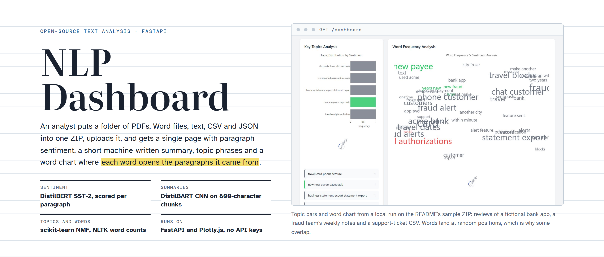
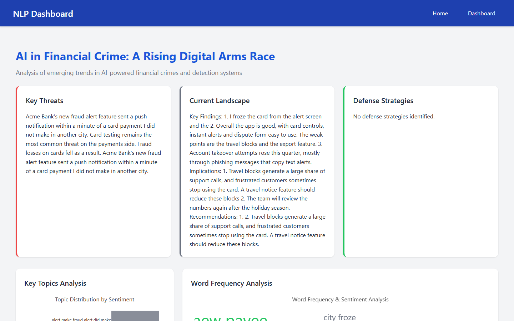
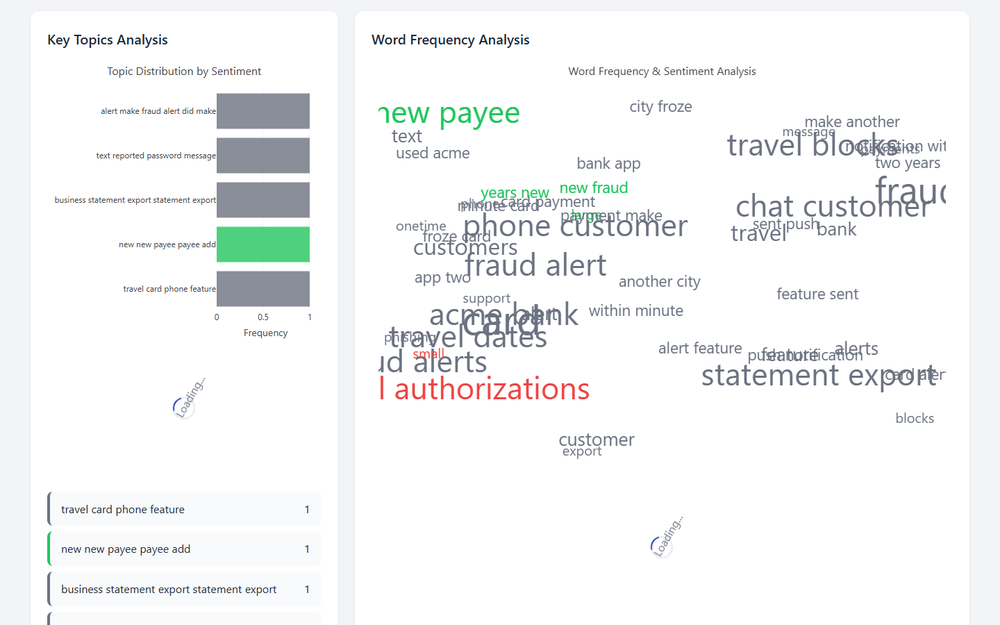
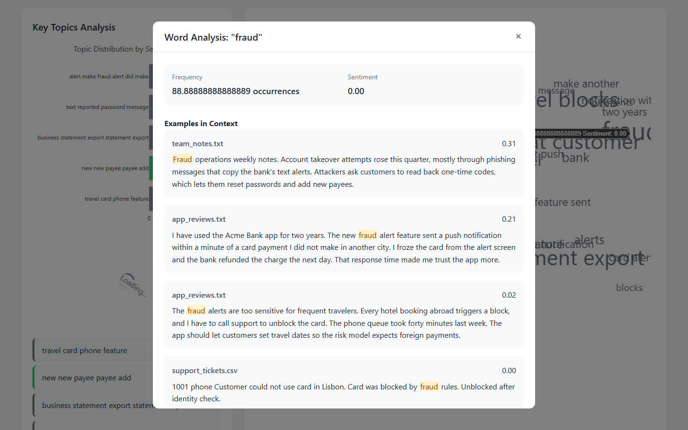
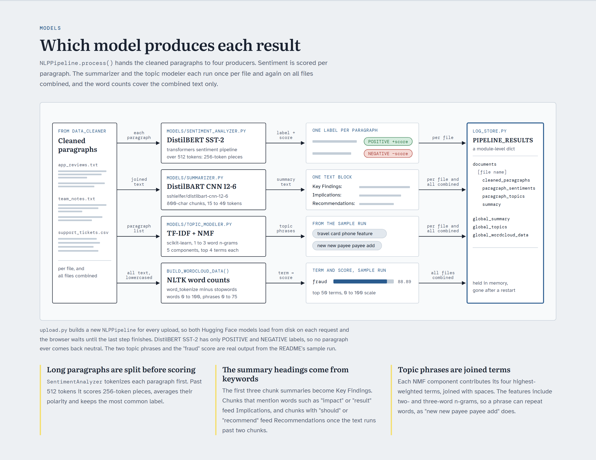
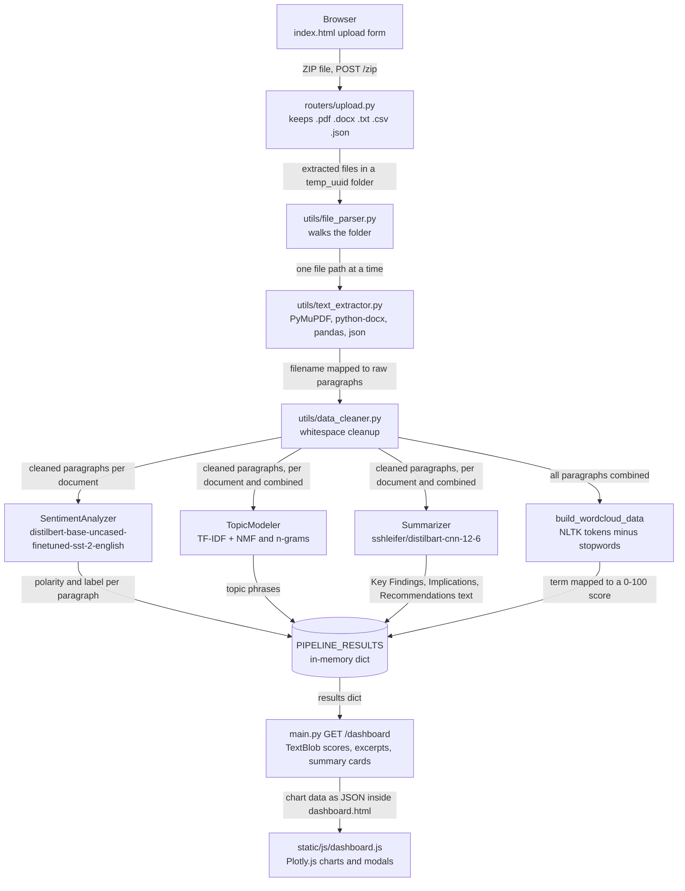
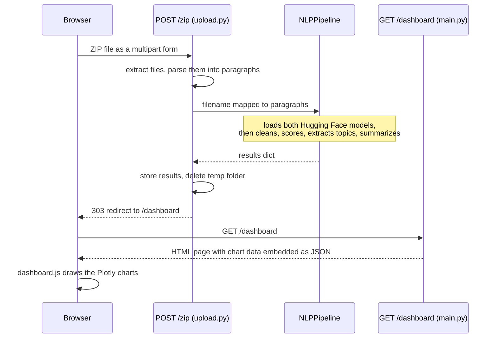

# NLP Dashboard App

<p align="center">
  <a href="https://nxtlupo.github.io/nlp_dashboard_app/">
    <picture>
      <source media="(prefers-color-scheme: dark)" srcset="docs/readme/overview-hero-dark.png">
      
    </picture>
  </a>
</p>

<p align="center"><b><a href="https://nxtlupo.github.io/nlp_dashboard_app/">Open the illustrated overview</a></b></p>

A FastAPI web app that takes a ZIP of documents, runs sentiment analysis, summarization and topic extraction on the text with Hugging Face models and scikit-learn, and draws the results on a Plotly dashboard.


## What the dashboard shows

These screenshots come from the app running locally on a made-up three-file corpus: reviews of a fictional "Acme Bank" mobile app, a fraud team's weekly notes, and a CSV of support tickets. The ZIP is in [`docs/readme/sample_corpus.zip`](docs/readme/sample_corpus.zip) if you want to reproduce them.



| Topic bar chart and word frequency chart | Clicking a word opens the paragraphs that contain it |
|---|---|
|  |  |

The page heading ("AI in Financial Crime") and the three card titles are fixed in the template, so every corpus gets them. The [limitations](#known-limitations) section covers that and the other rough edges visible in these images.

## How it works, at a glance

<picture>
  <source media="(prefers-color-scheme: dark)" srcset="docs/readme/overview-upload-dark.png">
  / in a finally block whether the pipeline succeeds or fails. Files are keyed by name alone, so when two folders each hold a notes.txt, the second one read replaces the first." src="docs/readme/overview-upload-light.png" width="100%">
</picture>

<picture>
  <source media="(prefers-color-scheme: dark)" srcset="docs/readme/overview-models-dark.png">
  
</picture>

<picture>
  <source media="(prefers-color-scheme: dark)" srcset="docs/readme/overview-dashboard-dark.png">
  
</picture>

The sections below give the full detail behind each picture.

## What the app does

| Feature | What it does | Where in the code |
|---|---|---|
| ZIP upload | Accepts one `.zip`, keeps `.pdf`, `.docx`, `.txt`, `.csv` and `.json` files, skips `__MACOSX`, `.DS_Store`, `Thumbs.db` and `desktop.ini`, and deletes the temp folder afterwards | [`app/routers/upload.py`](app/routers/upload.py#L40) |
| Text extraction | PyMuPDF reads PDF pages and splits them on blank lines; python-docx returns one paragraph per Word paragraph; plain text splits on blank lines; pandas turns each CSV row into one line; JSON lists and objects become one paragraph per item | [`app/utils/text_extractor.py`](app/utils/text_extractor.py#L58) |
| Cleaning | Trims each paragraph, collapses runs of whitespace, drops empty paragraphs | [`app/utils/data_cleaner.py`](app/utils/data_cleaner.py#L15) |
| Paragraph sentiment | The transformers `sentiment-analysis` pipeline with `distilbert-base-uncased-finetuned-sst-2-english` labels each paragraph POSITIVE or NEGATIVE; paragraphs over 512 tokens are split into 256-token pieces and averaged | [`app/models/sentiment_analyzer.py`](app/models/sentiment_analyzer.py#L10) |
| Summarization | `sshleifer/distilbart-cnn-12-6` summarizes 800-character chunks, and the summarizer assembles "Key Findings", "Implications" and "Recommendations" lists from those chunk summaries | [`app/models/summarizer.py`](app/models/summarizer.py#L12) |
| Topic extraction | scikit-learn `TfidfVectorizer` (1 to 3 word n-grams, English stop words) feeds a five-component NMF; the top four terms of each component form a topic phrase; the first five two-word phrases in the text are appended, duplicates are dropped and the first five survivors kept, so those phrases only appear when NMF topics repeat | [`app/models/topic_modeler.py`](app/models/topic_modeler.py#L27) |
| Word frequency data | NLTK `word_tokenize` and the NLTK English stopword list count words and two- and three-word phrases; the 50 highest are kept on a 0 to 100 scale | [`app/models/topic_modeler.py`](app/models/topic_modeler.py#L86) |
| Summary cards | The dashboard route sorts sentences of the corpus summary into "Key Threats", "Current Landscape" and "Defense Strategies" by keyword | [`app/main.py`](app/main.py#L325) |
| Term sentiment and excerpts | TextBlob scores each topic, word and excerpt (below -0.1 negative, above 0.1 positive); the route collects the paragraphs that contain each term | [`app/main.py`](app/main.py#L361) |
| Charts and drill-down | Plotly.js draws a horizontal topic bar chart and a word chart sized by frequency and colored by sentiment; clicking a bar or a word opens a modal with the matching paragraphs and the term highlighted | [`app/static/js/dashboard.js`](app/static/js/dashboard.js#L38) |
| Processing log | Each pipeline step and error is appended to an in-memory log that the home page and the dashboard print | [`app/log_store.py`](app/log_store.py) |

## What happens to an uploaded file



The upload router saves the ZIP into a new `temp_<uuid>` folder and extracts only the five supported file types. `file_parser.py` walks that folder and passes each file to `text_extractor.py`, which returns the file's paragraphs. What comes out is a dict that maps each filename to its list of paragraphs.

`NLPPipeline.process()` in [`app/models/nlp_pipeline.py`](app/models/nlp_pipeline.py) takes that dict. The cleaner normalizes whitespace first. DistilBERT then scores every paragraph and stores a signed polarity: the model's confidence for POSITIVE, or the negative of it for NEGATIVE. The topic modeler and the summarizer each run once per document and once more over the combined text of all documents; the word frequency data covers the whole corpus only. For the summary, DistilBART writes a short summary of each 800-character chunk. The first three chunk summaries become "Key Findings", chunks that mention words such as "impact" or "result" feed "Implications", and chunks containing "should" or "recommend" feed "Recommendations" once the text runs past two chunks.

After the pipeline returns, the router stores the output in the in-memory `PIPELINE_RESULTS` dict, removes the temp folder and redirects the browser to `/dashboard`. The dashboard route runs a second sentiment pass with TextBlob on each topic and word, counts the paragraphs that contain each topic phrase, collects excerpts for every term and embeds all of it in the page as JSON. In the browser, `dashboard.js` reads that JSON and draws the charts with Plotly.js, which the template loads from `cdn.plot.ly`.



## Run it locally

Use Python 3.11, the version this was tested with. The pinned `numpy==1.26.3` and `torch==2.2.0` have no wheels for Python 3.13.

```bash
git clone https://github.com/NXTLupo/nlp_dashboard_app.git
cd nlp_dashboard_app

python3.11 -m venv .venv
source .venv/bin/activate          # Windows: .venv\Scripts\activate

pip install -r requirements.txt

uvicorn app.main:app --reload      # add --port 8010 to use another port
```

Open http://127.0.0.1:8000, choose a ZIP (or [`docs/readme/sample_corpus.zip`](docs/readme/sample_corpus.zip)) and click "Upload ZIP". The browser stays on the upload page until the pipeline finishes, then lands on the dashboard.

Start the server from the repository root. `app/main.py` mounts `app/static` and `app/templates` by relative path, and it writes `app_logs_YYYYMMDD.log`, `temp/` and `logs/` into the current directory.

On the first upload, transformers downloads two models from the Hugging Face Hub into your local cache: about 256 MB for the DistilBERT sentiment model and 1.2 GB for DistilBART. NLTK fetches its `punkt`, `punkt_tab` and `stopwords` data during the same request. Later uploads load the models from disk.

[`requirements.txt`](requirements.txt) lists only the packages the code imports, at the versions pinned in the original [`requirements_info.txt`](requirements_info.txt). That older file also lists spaCy, gensim, sentence-transformers, wordcloud and other packages the app never imports, and you can skip them. Even the trimmed install is large: the test venv came to about 1.8 GB on Windows, most of it PyTorch.

How this was checked: a fresh Python 3.11 venv on Windows 11 installed `requirements.txt` without errors, `uvicorn app.main:app --port 4741` started, and the sample ZIP went through upload, pipeline and dashboard in about 25 seconds on CPU with the models already cached. The screenshots above come from that run.

### HTTP endpoints

| Method and path | What it returns | Result when tested |
|---|---|---|
| `GET /` | Upload page with the processing log | Works |
| `POST /zip` | Runs the pipeline, then a 303 redirect to `/dashboard` | Works |
| `GET /dashboard` | Dashboard page (placeholder text before the first upload) | Works |
| `GET /analysis-results` | Full pipeline output as JSON | Works |
| `GET /analysis-status`, `GET /upload-status` | Logged steps and errors | Works |
| `DELETE /clear-results` | Clears results and the log | Works |
| `GET /health` | Status, environment name, version | Works |
| `GET /docs` | FastAPI's Swagger UI | Works |
| `POST /run-pipeline` | Meant to analyze a folder already on the server | Returns 500, see limitations |
| `GET /results` | Meant to return chart-ready JSON | Returns 500, see limitations |
| `GET /download-results` | Writes a JSON file to `downloads/` and returns its URL | The returned URL is a 404 |

## Settings

[`app/config.py`](app/config.py) reads two environment variables, loading a `.env` file first with python-dotenv.

| Variable | Default | Used by | Effect |
|---|---|---|---|
| `ENVIRONMENT` | `development` | `app/main.py` | Reported by `/health`. When it is `development`, `python -m app.main` starts Uvicorn with auto-reload on `0.0.0.0:8000`. |
| `MODEL_PATH` | `models/bert-base-uncased` | nothing | Defined in `config.py`; no module reads it. |

Everything else is set in code:

| Setting | Value | File |
|---|---|---|
| Sentiment model | `distilbert-base-uncased-finetuned-sst-2-english` | `app/models/sentiment_analyzer.py:10` |
| Summarization model | `sshleifer/distilbart-cnn-12-6` | `app/models/summarizer.py:14` |
| Summary chunks | 800 characters each, summarized to 15 to 40 tokens | `app/models/summarizer.py:44`, `:109` |
| Sentiment chunking | Paragraphs over 512 tokens split into 256-token pieces | `app/models/sentiment_analyzer.py:19`, `:42` |
| Topics per document and per corpus | Up to 5 | `app/models/nlp_pipeline.py:59`, `:87` |
| TF-IDF | 1 to 3 word n-grams, up to 1,000 features, English stop words | `app/models/topic_modeler.py:45` |
| Word chart terms | Top 50 words longer than three letters plus top 30 phrases, 50 kept | `app/models/topic_modeler.py:103` |
| Dashboard sentiment buckets | TextBlob polarity below -0.1 negative, above 0.1 positive | `app/main.py:369` |
| Excerpts per term | 5, though the server loop can add one more for each extra document | `app/main.py:413`, `app/static/js/dashboard.js:273` |

## Who this is for

An analyst with a folder of mixed files, such as survey exports in CSV, PDF reports and interview notes in Word, can put them in one ZIP and get a first read on a single page. The page shows which paragraphs the sentiment model marks negative, which phrases repeat across files, and a short machine-written summary, and each word links back to the paragraphs it came from. No API keys are involved. Document text stays on your machine: the app's outbound requests go to the Hugging Face Hub and the NLTK data server for model and data files, and the browser fetches Plotly.js from its CDN.

For a developer, the repository is a small worked example of calling Hugging Face `pipeline()` models from FastAPI routes and handing the output to a Jinja template with a Plotly front end.

## Where the code lives

```text
nlp_dashboard_app/
├── app/
│   ├── main.py                 # FastAPI app, page routes, dashboard data prep, /health
│   ├── config.py               # ENVIRONMENT and MODEL_PATH from the environment or .env
│   ├── log_store.py            # in-memory PROCESSING_LOGS and PIPELINE_RESULTS dicts
│   ├── models/
│   │   ├── nlp_pipeline.py     # runs cleaning, sentiment, topics, summaries, word data
│   │   ├── sentiment_analyzer.py  # DistilBERT SST-2 through transformers
│   │   ├── summarizer.py       # DistilBART-CNN through transformers
│   │   └── topic_modeler.py    # TF-IDF + NMF, n-grams, word frequency data (NLTK)
│   ├── routers/
│   │   ├── upload.py           # POST /zip: unzip, parse, run the pipeline
│   │   ├── analyze.py          # /run-pipeline, /analysis-status, /analysis-results, /clear-results
│   │   ├── visualize.py        # /results, /download-results
│   │   └── _init_.py           # one comment line; Python loads app.routers as a namespace package
│   ├── utils/
│   │   ├── file_parser.py      # walks the extracted folder
│   │   ├── text_extractor.py   # PDF, DOCX, TXT, CSV, JSON to paragraphs
│   │   ├── data_cleaner.py     # whitespace cleanup
│   │   └── viz_utils.py        # placeholder functions, never called
│   ├── templates/              # Jinja2: base, index (upload), dashboard, error; modals.html has no route
│   └── static/
│       ├── js/dashboard.js     # Plotly charts, click handlers, modals
│       ├── js/app.js           # ZIP-only check on the upload form
│       └── css/styles.css      # not linked by any template
├── docs/readme/                # screenshots and the sample corpus used in this README
├── requirements.txt            # packages the code imports
└── requirements_info.txt       # the original, longer dependency list
```

## Known limitations

These come from reading the code and from the test run behind the screenshots.

How the app behaves:

- The dashboard heading, subtitle and card titles describe AI and financial crime ([`dashboard.html:289`](app/templates/dashboard.html#L289)), and `process_summary_sections` sorts sentences with threat and defense keyword lists ([`main.py:325`](app/main.py#L325)). A corpus on any other subject still gets those labels.
- Analysis runs inside the `POST /zip` request, and the router builds a new `NLPPipeline` for every upload ([`upload.py:104`](app/routers/upload.py#L104)). Both models load from disk each time, and the browser waits until the whole pipeline is done.
- Results live in one module-level dict ([`log_store.py`](app/log_store.py)). The app holds one analysis at a time, every visitor sees the same one, and a restart erases it. The processing log keeps growing across uploads until `DELETE /clear-results`.
- Two sentiment models are in play. DistilBERT SST-2 has only POSITIVE and NEGATIVE labels, so no paragraph is ever neutral. TextBlob, which sets the chart colors, returns 0.0 for most single words, which is why most terms in the word chart are grey.
- NMF topic phrases join top-weighted terms that rarely sit next to each other in the text ("travel card phone feature" in the sample run). The exact-phrase search then finds no excerpts for them, and the frequency falls back to 1 ([`main.py:393`](app/main.py#L393)).
- The word chart places terms at random coordinates ([`dashboard.js:116`](app/static/js/dashboard.js#L116)), so words overlap, get clipped at the edges and move on every reload or resize. The `wordcloud` package listed in `requirements_info.txt` is not used.
- The browser loads Plotly.js from `cdn.plot.ly` ([`dashboard.html:5`](app/templates/dashboard.html#L5)). Without internet access the charts do not render.
- There is no authentication and no upload size limit, and CORS allows every origin ([`main.py:40`](app/main.py#L40)).
- The repository has no tests.

Bugs found while writing this README. They are left as they are; this change touched only documentation and `requirements.txt`.

- `POST /run-pipeline` passes `max_topics`, `include_raw` and `detailed_sentiment` to `NLPPipeline.process()`, which accepts none of them, so every call returns 500 with a `TypeError` ([`analyze.py:129`](app/routers/analyze.py#L129)).
- `GET /results` calls `.get()` on word scores that are floats and returns 500 with an `AttributeError` ([`visualize.py:146`](app/routers/visualize.py#L146)).
- `GET /download-results` returns a `/downloads/...` URL, but no route or static mount serves that path ([`visualize.py:242`](app/routers/visualize.py#L242)).
- The stop-phrase filter matches `"et"` as a substring ([`topic_modeler.py:17`](app/models/topic_modeler.py#L17), [`:164`](app/models/topic_modeler.py#L164)), so any n-gram containing "get", "market", "better" or "ticket" is dropped from the topics and from the word chart.
- The word modal labels the 0 to 100 frequency score as "occurrences" ([`dashboard.js:218`](app/static/js/dashboard.js#L218)); that is where "88.88888888888889 occurrences" in the screenshot comes from.
- The "Loading..." placeholders inside both chart containers stay on the page after Plotly draws ([`dashboard.html:321`](app/templates/dashboard.html#L321), [`:337`](app/templates/dashboard.html#L337)), and they show below the charts.
- The summary cards split the text on every period ([`main.py:344`](app/main.py#L344)), which breaks numbered items such as "1." into fragments.
- The topic list under the bar chart is styled as clickable, but nothing attaches a click handler to it. Only the bars and the words open a modal.
